# DAMA 학습 가이드

> 이 문서는 지금까지 저장소에서 진행된 작업을 공부하기 위한 정리본이다.
> 근거: `CLAUDE.md`, `README.md`, `docs/schema.md`, `docs/security.md`, `git log`, `src/`, `supabase/migrations/`, `tests/`, `worker.ts`, `wrangler.jsonc`, `scripts/`.
> 코드나 문서에서 확인하지 못한 내용은 **확인 필요**로 표시했다.
> 기준 시점: 커밋 `4b72220` (2026-10-13).

---

## 1. 한눈에 보기

**무엇을 만드나** — 커플이 함께한 추억(사진·메모·날짜·장소·태그)을 기록하고, 지도에서 날짜별 데이트 동선을 보고, 다른 커플이 **직접 공개한** 장소·코스를 발견하는 웹 서비스. 데모가 아니라 실제 사용자용 제품이다.

| 기능 | 핵심 |
|---|---|
| Couple Memory | 기록은 기본 `draft`(나만 보기), 작성자만 `shared`로 전환. 타임라인·검색·필터 |
| 사진 업로드 | 브라우저에서 EXIF 읽기 → 사용자 확인·수정 → WebP 재인코딩(EXIF 없음) → 비공개 Storage |
| Memory Map | `memory_places`를 MapLibre로 표시, 같은 날 장소를 **기록 순서**로 점선 연결("실제 이동 경로 아님" 범례) |
| Date Discovery | 기록의 **사본**으로 공개 글 작성, 좋아요·북마크·신고·차단, 운영자 검토 |
| 계정 | 이메일+비밀번호(이메일 인증 필수), 비밀번호 재설정, 데이터 내보내기, 회원 탈퇴 |

**기술 스택** (`package.json` 기준)

- Next.js `16.4.0` + React `19.3.0` + TypeScript, Tailwind v4, shadcn/ui 구성(`components.json`)
- Supabase: Auth / Postgres / Storage / RLS (`@supabase/ssr`, `@supabase/supabase-js`)
- 지도: `maplibre-gl` + 키 없는 OpenFreeMap 스타일(기본값 `https://tiles.openfreemap.org/styles/positron`)
- 사진: `exifr`(EXIF), `heic-to`(HEIC 변환, LGPL, 지연 로드)
- 배포: Cloudflare Workers + `@opennextjs/cloudflare 1.20.7`(patch-package로 패치), `wrangler`
- 검증: `zod`(`@/lib/zod`에서 jitless 설정), 테스트는 Vitest(unit/db) + Playwright(e2e)

**핵심 원칙 3가지**

1. **프라이버시 우선** — 공개는 항상 명시적 선택, 상대에게 자동 공유 없음, 공개 이미지는 메타데이터 제거, 위치는 출처(`exif`/`device`/`manual`)·정확도 구분 저장, "함께 있었다"는 단정하지 않고 후보로만.
2. **RLS 격리** — 모든 커플 데이터는 `couple_id` 기준으로 DB의 RLS가 강제한다. 프런트 검증은 보조일 뿐.
3. **정직한 구현** — 브라우저로 안 되는 것(백그라운드 사진 감지, 주소 검색 등)은 된 척하지 않는다. 지도 연결선은 기록 순서임을 항상 표시한다. 샘플 데이터는 `[샘플]` 표시.

---

## 2. 진행 타임라인

전체 커밋 14개, 2026-10-12 17:52 UTC ~ 2026-10-13 14:52 UTC.

| # | 커밋 | 날짜(UTC) | 마일스톤 | 주요 내용 |
|---|---|---|---|---|
| 1 | `a1b643e` | 10-12 17:52 | 기반 + 커플 연결 | Next 16 스캐폴드, 디자인 토큰, `profiles`/`couples`/`couple_members`/`couple_invites` + RLS, 초대·수락·해제 RPC, 이메일 인증, 테스트 3종 기반, `docs/schema.md` |
| 2 | `6466bfa` | 10-12 18:03 | Couple Memory | `memories`(draft/shared), `tags text[]`, `search_memories`, 해제 후 보관·JSON 내보내기, seed |
| 3 | `7289941` | 10-12 18:25 | 사진 | EXIF 확인 후 저장, WebP 재인코딩, 기록 후보 묶기, `couple-photos` 비공개 버킷, 파일 삭제 대기열 + cron 라우트 |
| 4 | `69f8d7a` | 10-13 02:26 | Memory Map | `memory_places`, 장소 입력 3가지(지도·EXIF·기기), 날짜별 코스, 지도 실패 시 단색 배경 |
| 5 | `13c5ebc` | 10-13 03:07 | Date Discovery | 공개 사본, `post-images` 버킷 + 서버 메타데이터 제거, 좋아요·저장·신고·차단, 신고 3명 자동 검토 |
| 6 | `9abd521` | 10-13 03:26 | 운영·보완 | `/admin/reports` 신고 검토, 공개 글 수정, 사진 붙이기, HEIC, 서명 URL 10분 |
| 7 | `0c8d91b` | 10-13 03:27 | 문서 | 운영·HEIC·서드파티 라이선스 문서화 |
| 8 | `1236923` | 10-13 03:45 | 배포 | DB 타입 생성(`gen:types`), Cloudflare Workers(OpenNext) + 크론, OpenNext 패치 |
| 9 | `2eed221` | 10-13 04:11 | 보안 점검 | nonce CSP, HEIC 디코더 전용 워커, 로그인·가입 브라우저 호출, 일일 생성 제한, DB 보안 불변식 테스트 |
| 10 | `3d6840d` | 10-13 04:31 | 계정 | 비밀번호 재설정, 설정, 데이터 내보내기, 회원 탈퇴(service_role 사용처 2곳 확정) |
| 11 | `406f135` | 10-13 08:59 | 성능 | Supabase advisor 지적 FK 인덱스 추가, 원격 프로젝트 설정 문서화 |
| 12 | `daa2898` | 10-13 13:38 | 검증 | 원격 격리 스모크 테스트 결과 문서화 |
| 13 | `058a21d` | 10-13 14:35 | 보안 수정 | OpenNext 번들에서 `NEXT_PUBLIC_*` 외 환경 변수 제거(`sanitize-next-env.mjs`) |
| 14 | `4b72220` | 10-13 14:52 | 보안 수정 | 초대 토큰을 URL fragment(`/invite#토큰`)로 이동 |

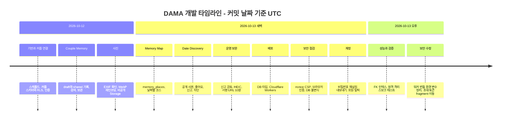

**흐름 요약** — 데이터 격리(커플·RLS) → 핵심 기능(기록 → 사진 → 지도 → 발견) → 운영(신고 검토) → 배포 → 보안 점검 → 계정 수명주기 → 원격 검증·보안 후속 수정 순서로 진행됐다.

---

## 3. C4 모델

### 3.1 Level 1 — System Context

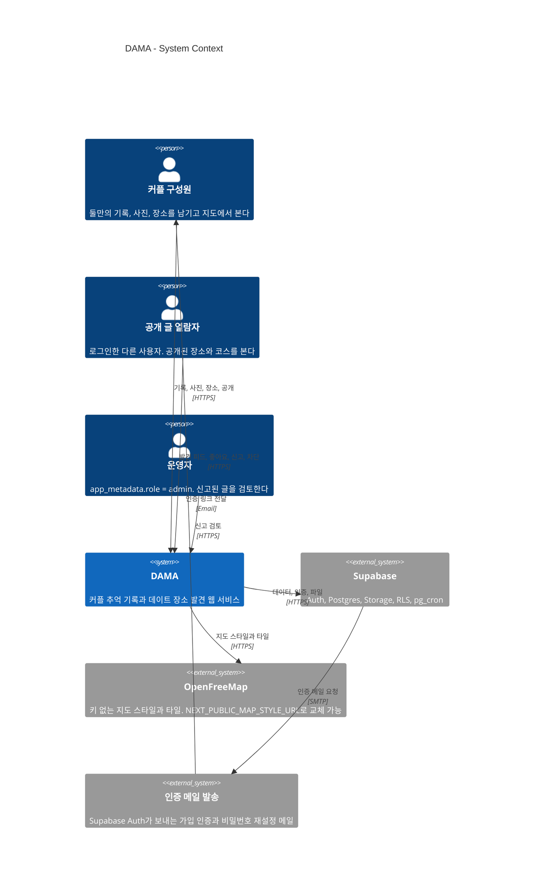

- 외부 시스템은 코드에서 확인된 것만 넣었다: Supabase(`src/lib/supabase/*`), OpenFreeMap(`src/features/map/map-view.tsx`, `src/lib/security/csp.ts`), 메일(Supabase Auth의 인증 메일).
- 로컬에서는 메일을 Mailpit(54324)이 받는다(`tests/e2e/helpers.ts`). **운영 SMTP 제공자는 확인 필요** — `README.md`·`docs/security.md` 체크리스트에 "커스텀 SMTP 설정"이 할 일로만 적혀 있다.
- 공개 글 열람자도 로그인 사용자여야 한다(발견은 로그인 필요, 익명 크롤링 방지 — `docs/schema.md`). 유료 AI API·지오코딩 서비스는 없다.

### 3.2 Level 2 — Container

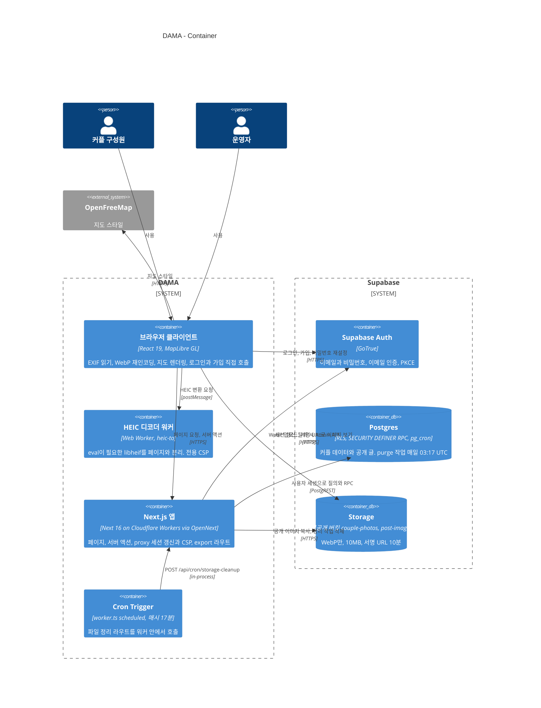

- 로그인·가입·비밀번호 재설정은 **브라우저가 Supabase Auth를 직접** 부른다(`src/features/auth/client-auth.ts`). Auth 한도가 IP 단위라 워커 IP로 몰리면 전체 사용자가 막힐 수 있기 때문.
- 정기 작업은 두 개다: Cloudflare Cron(`wrangler.jsonc`의 `17 * * * *`) → 파일 정리, DB의 pg_cron(`17 3 * * *`) → `private.purge_dissolved_couples()`.
- 사진 원본은 서버로 가지 않는다. 브라우저가 WebP로 재인코딩한 파일만 Storage에 직접 올리고, 서버 액션(`savePhotos`)은 행만 만든다.

### 3.3 Level 3 — Component (Next.js 앱 내부)

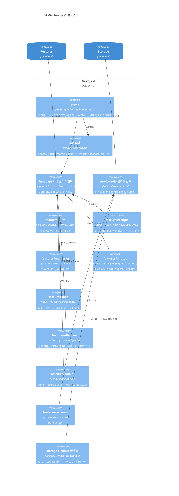

- 기능 코드는 `src/features/<기능>/`에 모여 있고 라우트는 `src/app/(app)`(로그인 필요), `src/app/(auth)`(로그인·가입·재설정), `src/app/auth/callback`(PKCE 코드 교환), `src/app/api/cron`에 있다.
- 거의 모든 서버 코드는 **사용자 세션 클라이언트**를 쓰므로 권한 판단은 DB의 RLS가 한다. RLS를 우회하는 `admin.ts`는 두 곳(탈퇴·파일 정리)에서만 쓰인다.
- `proxy.ts`의 보호 경로는 UX용 1차 관문이다: `/home`, `/couple`, `/memories`, `/photos`, `/map`, `/discover`, `/invite`, `/admin`, `/settings`. 실제 권한 검증은 DB가 다시 한다.

### 3.4 Deployment

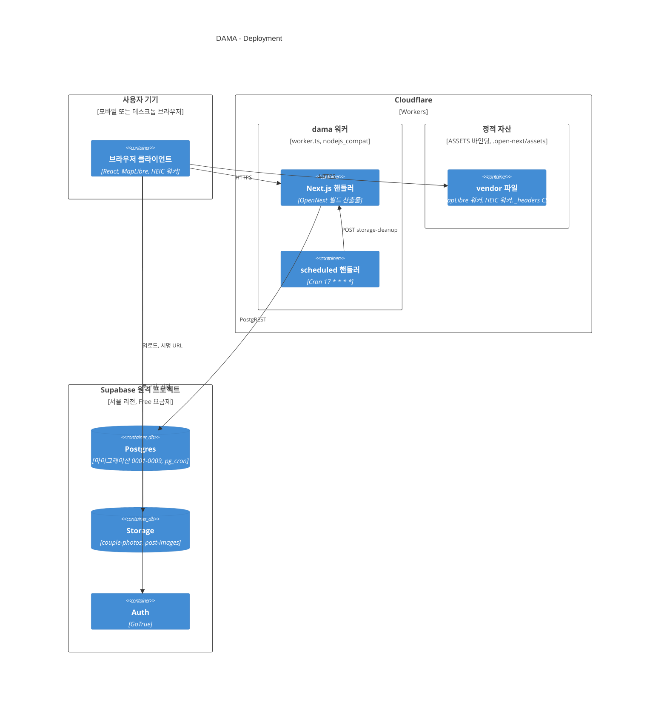

- 배포 주소 `https://dama.dama-app.workers.dev`(CLAUDE.md). 서버 비밀값(`SUPABASE_SERVICE_ROLE_KEY`, `CRON_SECRET`)은 `wrangler secret put`으로만 넣는다.
- `cf:build`/`cf:deploy` 후 `scripts/sanitize-next-env.mjs`가 `next-env.mjs`에서 `NEXT_PUBLIC_*`만 남긴다. `--deploy` 모드에서는 로컬 Supabase 주소면 중단한다.
- 원격 Supabase 정보(서울, Free, 마이그레이션 0001~0009 적용, seed 미적용)는 `docs/security.md` 기준. 원격 마이그레이션 이력 번호가 로컬 파일명과 다르므로 `db push` 전 `supabase migration repair`가 필요하다고 기록돼 있다.
- 현재 배포본이 마지막 커밋(`4b72220`)까지 반영됐는지는 **확인 필요**.

---

## 4. 데이터 모델

`supabase/migrations/*.sql` 기준. public 테이블 14개 + private 테이블 2개.

```mermaid
erDiagram
    AUTH_USERS ||--|| profiles : "1대1"
    AUTH_USERS ||--o{ couple_members : "멤버십"
    couples ||--o{ couple_members : "최대 2명 활성"
    couples ||--o{ couple_invites : "초대"
    couples ||--o{ memories : "couple_id 격리"
    couples ||--o{ photos : "couple_id 격리"
    couples ||--o{ memory_places : "couple_id 격리"
    AUTH_USERS ||--o{ memories : "author_id"
    AUTH_USERS ||--o{ photos : "uploader_id"
    memories ||--o{ photos : "memory_id null 가능"
    memories ||--o{ memory_places : "가시성 = 기록"
    AUTH_USERS ||--o{ public_posts : "author_id"
    public_posts ||--o{ public_post_places : "사본 장소"
    public_posts ||--o{ public_post_images : "사본 이미지"
    public_posts ||--o{ post_likes : "좋아요"
    public_posts ||--o{ post_bookmarks : "북마크"
    public_posts ||--o{ post_reports : "신고"
    AUTH_USERS ||--o{ user_blocks : "blocker와 blocked"

    AUTH_USERS {
        uuid id PK
    }
    profiles {
        uuid id PK "auth.users.id"
        text display_name
        text avatar_path "쓰기 권한 회수됨"
    }
    couples {
        uuid id PK
        text name
        date anniversary_on
        text status "active 또는 dissolved"
        timestamptz dissolved_at
        timestamptz purge_after "해제 후 30일"
    }
    couple_members {
        uuid couple_id PK,FK
        uuid user_id PK,FK
        timestamptz joined_at
        timestamptz left_at "null이면 활성"
    }
    couple_invites {
        uuid id PK
        uuid couple_id FK
        bytea token_hash "sha256, 클라이언트 비노출"
        timestamptz expires_at "24시간"
        timestamptz used_at
        uuid used_by
        timestamptz revoked_at
    }
    memories {
        uuid id PK
        uuid couple_id FK
        uuid author_id FK
        text title
        text body
        date happened_on
        text_array tags
        text share_status "draft 또는 shared"
        timestamptz shared_at "트리거가 설정"
    }
    photos {
        uuid id PK
        uuid couple_id FK
        uuid uploader_id FK
        uuid memory_id FK
        text storage_path "couple_id/uploader_id/id.webp"
        text thumb_path
        timestamptz taken_at
        text taken_at_source "exif 또는 manual"
        numeric lat
        numeric lng
        text location_source "exif, device, manual"
        numeric accuracy_m
    }
    memory_places {
        uuid id PK
        uuid memory_id FK
        uuid couple_id FK
        int seq "기록 안의 순서"
        text name
        numeric lat
        numeric lng
        text location_source "exif, device, manual"
        numeric accuracy_m "manual이면 null"
    }
    public_posts {
        uuid id PK
        uuid author_id FK
        text kind "place 또는 course"
        text title
        text status "published, hidden, under_review, removed"
        int like_count
        int bookmark_count
    }
    public_post_places {
        uuid id PK
        uuid post_id FK
        int seq
        text name
        numeric lat
        numeric lng
    }
    public_post_images {
        uuid id PK
        uuid post_id FK
        text storage_path "post-images 버킷"
    }
    post_likes {
        uuid post_id PK,FK
        uuid user_id PK,FK
    }
    post_bookmarks {
        uuid post_id PK,FK
        uuid user_id PK,FK
    }
    post_reports {
        uuid id PK
        uuid post_id FK
        uuid reporter_id FK
        text reason "spam, inappropriate, privacy, other"
        text status "open, resolved, dismissed"
    }
    user_blocks {
        uuid blocker_id PK,FK
        uuid blocked_id PK,FK
    }
```

**읽는 법**

- **couple_id 격리 축**: `memories`, `photos`, `memory_places`가 `couple_id`를 갖고 RLS가 `private.is_active_member(couple_id)`(또는 보관 중이면 `private.in_archive`)로 검사한다. `couple_invites`도 활성 멤버만 본다.
- **발견 영역에는 `couple_id`가 없다**: `public_posts`는 원본 기록 id도 저장하지 않는 사본이다. 기록을 지워도 공개 글은 남고 그 반대도 마찬가지.
- 모든 사용자 FK는 `auth.users ... on delete cascade` → 탈퇴 시 DB가 연쇄 삭제한다. `photos.memory_id`만 `on delete set null`.
- 불변 조건: 사용자당 활성 커플 1개(부분 유니크 인덱스 `couple_members(user_id) where left_at is null`), 커플당 활성 2명(트리거 `enforce_couple_capacity`, 커플 행 잠금).
- private 스키마 테이블(다이어그램 생략): `private.storage_deletion_queue`(삭제할 Storage 경로), `private.moderation_log`(운영 결정 기록). API로 노출되지 않는다.
- Storage 버킷 2개(`couple-photos`, `post-images`) 모두 비공개·WebP만·10MB.

---

## 5. 핵심 흐름

### 5.1 커플 초대 링크

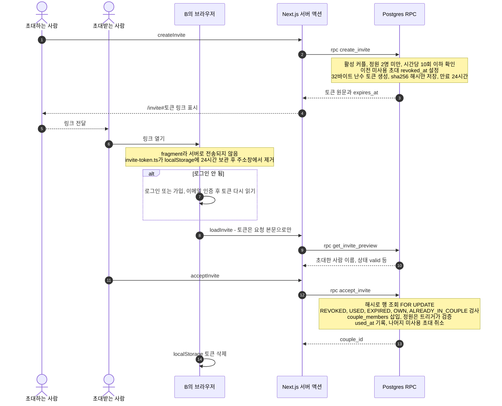

- 토큰 원문은 DB에 저장되지 않고 `token_hash` 컬럼은 클라이언트가 읽을 수 없다(`tests/db/couple-linking.test.ts`).
- 오류는 대문자 코드(`INVITE_EXPIRED` 등)로 던지고 `src/features/couple/errors.ts`가 한국어 문구로 바꾼다. 문구 누락은 `tests/unit/couple-errors.test.ts`가 잡는다.
- E2E가 "어떤 요청 URL에도 토큰이 없음"을 검사한다(커밋 `4b72220`).

### 5.2 사진 업로드

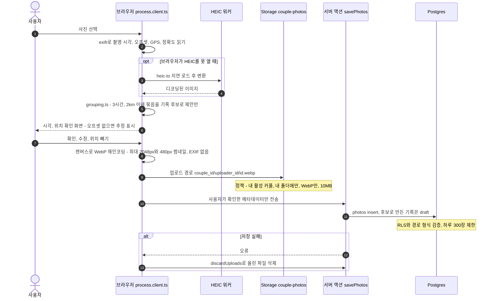

- 원본 파일은 기기를 떠나지 않는다. 저장된 파일은 재인코딩 결과라 EXIF가 없다.
- 상대는 **공유된 기록에 붙은 사진만** 본다. 기록을 다시 `draft`로 돌리면 즉시 안 보인다(`tests/db/photos.test.ts`).
- 사진 보기는 서명 URL(코드상 10분, `src/features/photos/queries.ts`). `docs/schema.md`도 10분으로 맞췄다.

### 5.3 기록 공개 (Date Discovery)

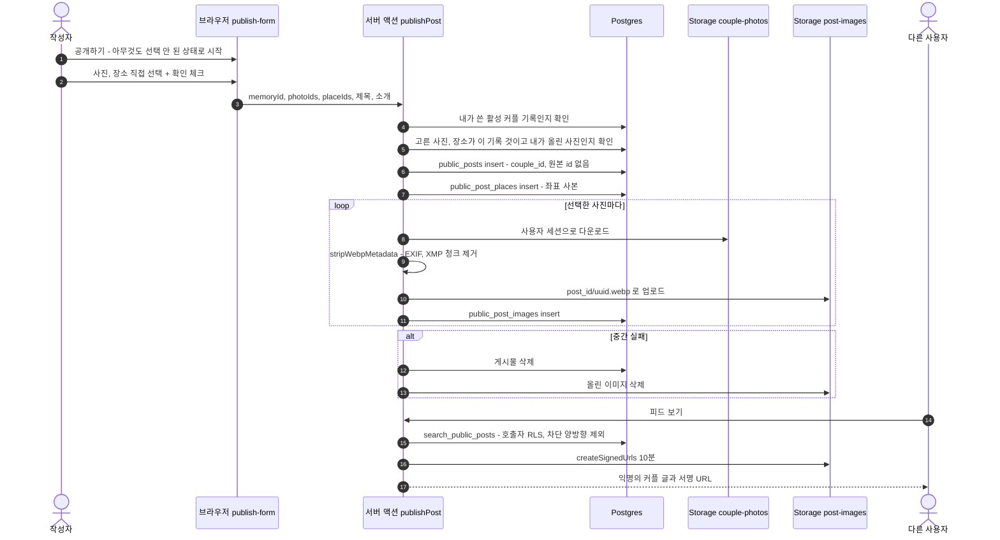

- 공개 글 상태는 `published` / `hidden` / `under_review` / `removed`. 서로 다른 3명이 신고하면 트리거 `auto_hide_reported`가 `under_review`로 바꾼다.
- 이미지 버킷이 비공개라 숨김·삭제·차단된 글의 이미지는 새로 열 수 없다. 이미 발급된 URL은 최대 10분 유효(남은 위험으로 문서화).

### 5.4 연결 해제와 30일 후 purge

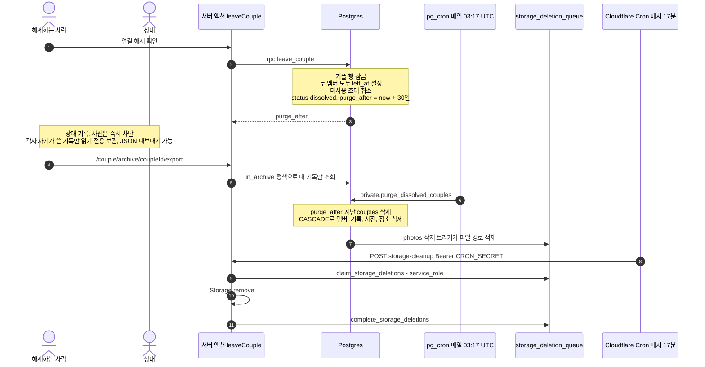

- 해제 후 각자 새 커플을 만들 수 있고, 예전 초대 링크는 쓸 수 없다(`tests/db/dissolution.test.ts`).
- 행이 지워지는 순간 Storage 정책상 파일은 이미 읽을 수 없고, 실제 파일 삭제만 대기열로 늦게 처리된다.

### 5.5 회원 탈퇴

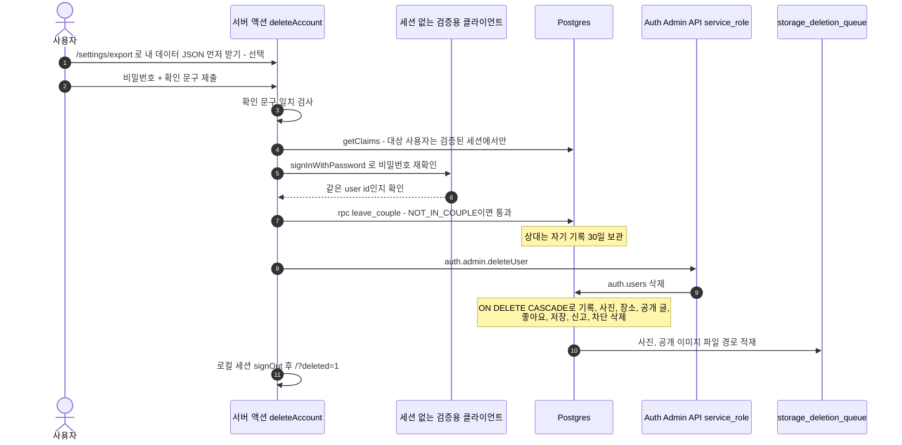

- 내보내기에는 사진 파일이 포함되지 않는다(기록·장소·사진 정보·공개 글만, `docs/security.md`).
- 검증: `tests/db/account-deletion.test.ts`(cascade와 대기열, 상대 데이터 유지), `tests/e2e/account.spec.ts`.

---

## 6. 상태 다이어그램

### 6.1 커플 상태 — `couples.status in ('active', 'dissolved')`

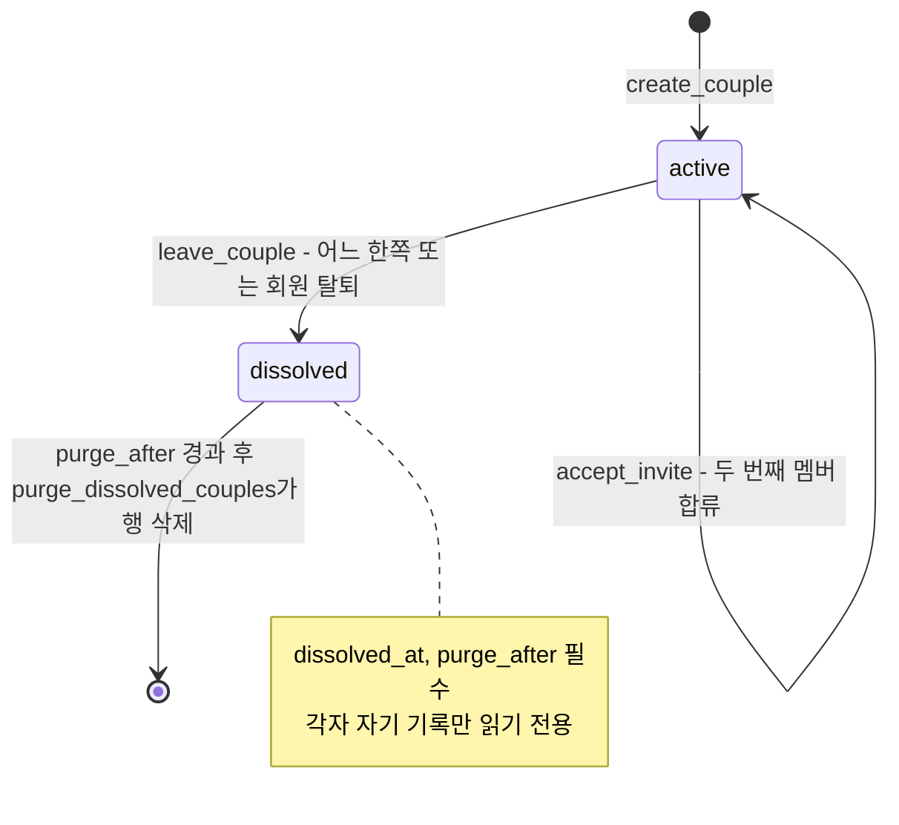

`couples_dissolved_consistency` CHECK가 `active`이면 `dissolved_at`/`purge_after`가 null, `dissolved`이면 둘 다 not null임을 강제한다. 별도의 "삭제됨" 상태는 없고 행 자체가 지워진다.

### 6.2 기록 가시성 — `memories.share_status in ('draft', 'shared')`

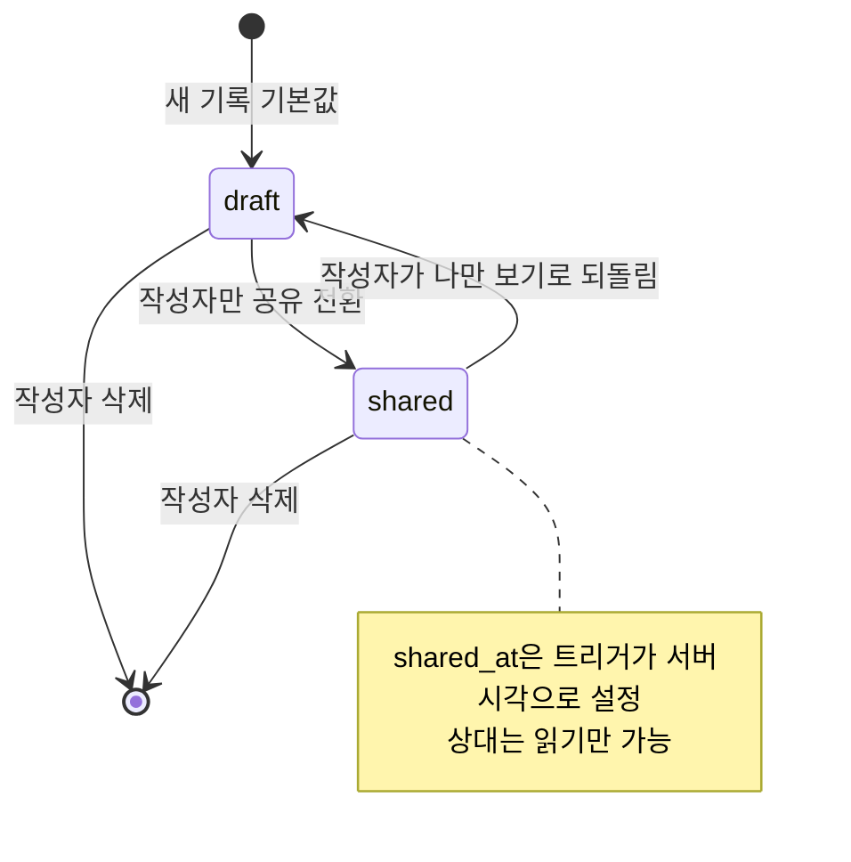

`check ((share_status = 'shared') = (shared_at is not null))`. 장소·사진의 상대 가시성이 이 상태를 그대로 따른다.

### 6.3 공개 글 — `public_posts.status in ('published', 'hidden', 'under_review', 'removed')`

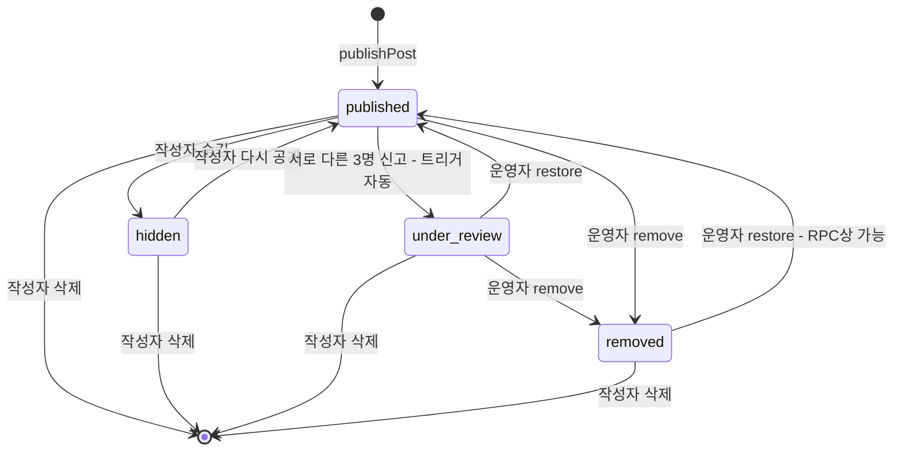

- 작성자는 RLS(`public_posts_update`)로 `published`↔`hidden`만 바꿀 수 있고 `under_review`·`removed`에서는 수정·재공개 불가, 삭제만 가능.
- `moderate_post`는 `status <> 'hidden'`인 글만 처리하므로 작성자가 숨긴 글은 운영자도 못 건드린다(`POST_NOT_FOUND`). 즉 RPC 자체는 `published`·`under_review`·`removed` 어느 상태에서든 restore→`published`, remove→`removed`로 바꿀 수 있다. 다만 운영자 화면이 쓰는 `admin_report_queue`는 열린 신고가 있거나 `under_review`인 글만 보여주고, 운영자 select 정책도 신고가 있거나 `under_review`/`removed`인 글로 한정된다. 화면에서 `removed` 글을 다시 restore하는 동선이 있는지는 **확인 필요**.
- 결정은 모두 `private.moderation_log`에 남는다.
- 신고 행 상태(`post_reports.status`): `open` → restore 시 `dismissed`, remove 시 `resolved`.

---

## 7. 보안 레이어

| 레이어 | 내용 | 위치 |
|---|---|---|
| RLS | public 테이블 14개 모두 RLS. 정책은 `authenticated` 대상, `using(true)` 없음. 커플 데이터는 `private.is_active_member(couple_id)` | `supabase/migrations/*`, `tests/db/rls-isolation.test.ts` |
| 테이블 권한 | 새 테이블은 `revoke all ... from public, anon, authenticated` 후 필요한 컬럼만 grant. 예: `memories`는 `couple_id`·`author_id`·`shared_at` 수정 불가, `profiles.avatar_path` 쓰기 회수 | 마이그레이션 |
| SECURITY DEFINER 규칙 | 상태 전이·남의 행을 건드리는 작업만. `set search_path = ''` 필수, 오류는 대문자 코드. authenticated가 부를 수 있는 것은 검토된 8개: `accept_invite`, `admin_report_queue`, `create_couple`, `create_invite`, `get_invite_preview`, `leave_couple`, `moderate_post`, `revoke_invite` | `tests/db/security-invariants.test.ts` |
| RLS 헬퍼 | `private` 스키마(API 비노출): `is_active_member`, `was_member`, `in_archive`, `my_active_couple_id`, `blocked_between`, `is_admin` 등 | 마이그레이션 |
| 검색 RPC | `search_memories`, `search_public_posts`, `my_memory_tags`, `move_memory_place`는 SECURITY INVOKER → 호출자 RLS 그대로 | 마이그레이션 |
| 남용 방지 | 하루 사진 300·기록 200·공개 글 10·신고 20, 시간당 초대 10 (DB 트리거) | `0008_security_hardening` 등 |
| CSP | proxy가 요청마다 nonce 생성. `script-src 'self' 'nonce-…' 'strict-dynamic' 'wasm-unsafe-eval'`(개발 모드만 `unsafe-eval`), `connect-src`는 self·Supabase·지도 서버, `frame-ancestors 'none'`, HTTPS면 HSTS·`upgrade-insecure-requests` | `src/lib/security/csp.ts`, `src/lib/supabase/proxy.ts` |
| eval 격리 | HEIC 디코더는 `/vendor/heic/heic-worker.mjs` 전용 워커, 그 경로만 eval 허용·네트워크 차단 CSP | `next.config.ts`, `public/_headers` |
| zod jitless | zod의 `Function("")` 탐지로 인한 CSP 위반 방지 | `src/lib/zod.ts` |
| 인증 | 로그인·가입·재설정은 브라우저에서(IP 단위 rate limit). 계정 존재 여부 비노출. PKCE 콜백. 오픈 리다이렉트 차단 | `src/features/auth/client-auth.ts`, `src/lib/safe-redirect.ts` |
| service_role | **정확히 두 곳**: ① `/api/cron/storage-cleanup`(CRON_SECRET 16자 이상, `timingSafeEqual`) ② 회원 탈퇴 `deleteAccount`(세션 사용자 본인, 비밀번호 재확인 후) | `src/lib/supabase/admin.ts` |
| 비밀값 | 브라우저 노출 금지, `.env.example`로 문서화. 워커 번들에서 `NEXT_PUBLIC_*` 외 제거 | `scripts/sanitize-next-env.mjs` |
| 이미지 | 저장 사진은 브라우저 재인코딩(EXIF 없음), 공개 이미지는 서버에서 WebP EXIF·XMP 청크 한 번 더 제거. 버킷 비공개, 서명 URL 10분 | `src/features/discover/webp-strip.ts` |

**테스트로 검증하는 방법**

- `npm run test:db` — Docker 없이 임시 Postgres + `tests/db/supabase-shim.sql` + 모든 마이그레이션을 적용해 실행. `DATABASE_URL`을 주면 실제 Supabase DB(예: 54322)에 대해 실행.
- `security-invariants.test.ts`는 DB 카탈로그를 조회해 규칙 위반(anon 권한, search_path 미고정, 검토 안 된 DEFINER 함수, RLS 누락)을 잡는다 → **새 마이그레이션이 규칙을 어기면 테스트가 실패**한다.
- `tests/e2e/security.spec.ts` — 요청마다 다른 nonce, 인라인 스크립트 nonce, 주요 화면 CSP 위반 0, 계정 존재 비노출.
- 원격 프로젝트에도 트랜잭션 안에서 격리 스모크 테스트를 실행하고 롤백했다(`docs/security.md` "원격 프로젝트").

**남은 위험(문서화됨)**: 토큰 갱신이 워커 IP 단위 한도를 공유, 이미 발급된 서명 URL 최대 10분, 비공개 사진은 MIME·크기만 검증, OpenNext의 Node 미들웨어가 "실험적", 개발 도구의 `npm audit` 경고.

---

## 8. 테스트 전략

| 종류 | 명령 | 환경 | 무엇을 검증하나 | 파일 |
|---|---|---|---|---|
| Unit | `npm run test:unit` | Vitest | 입력 검증(가입·태그), 오류 코드 → 문구 매핑 누락, 코스 정렬·연결선 규칙, CSP 문자열, EXIF 파싱(오프셋 유무), 오픈 리다이렉트 방지, WebP 메타데이터 제거 | `tests/unit/*.test.ts` (8개) |
| DB | `npm run test:db` | 임시 Postgres + shim, 또는 `DATABASE_URL` | 커플 간 격리, 초대 토큰 해시·만료·재사용, draft/shared 규칙, 사진·장소 가시성, 해제·보관·purge, 발견 가시성·차단·신고, 운영 권한, 탈퇴 cascade, 보안 불변식 | `tests/db/*.test.ts` (10개) |
| E2E | `npm run test:e2e` | Playwright + `supabase start` + `.env.local`, 메일은 Mailpit | 두 계정 연결·제3자 차단·해제, 기록 흐름, 사진 EXIF 확인→업로드, 지도 장소 추가·코스, 발견 전체 흐름, HEIC, 신고 검토, 보안 헤더·CSP, 비밀번호 재설정·탈퇴, 파일 정리(키 있을 때만) | `tests/e2e/*.spec.ts` (9개 + helpers) |
| 정적 | `npm run lint`, `npm run typecheck`, `npm run build` | — | 린트, 생성된 DB 타입 기준 타입 검사, 빌드 | — |

- 사진 픽스처(`tests/fixtures/forest-1.jpg`, `forest-2.jpg`, `no-gps.jpg`, `synthetic.heic`)는 EXIF 값을 알고 있는 합성 이미지다.
- 커밋 메시지상 E2E는 Node 서버와 workerd(`npm run cf:preview`) 양쪽에서 통과했다고 기록돼 있다.
- CI 설정(`.github/workflows`)은 저장소에 없다 → 자동 실행 여부 **확인 필요**(현재는 수동 실행으로 보임).

---

## 9. 복습 질문

Q1. 초대 토큰을 왜 URL 경로가 아니라 <code>/invite#토큰</code> fragment에 넣었나?

fragment는 브라우저가 서버로 보내지 않으므로 요청 로그·Referer에 남지 않는다. 브라우저가 토큰을 읽어 주소창에서 지우고 서버 액션 본문으로만 보낸다(커밋 `4b72220`).

Q2. DB에는 초대 토큰의 무엇이 저장되고, 클라이언트는 그것을 읽을 수 있나?

sha256 해시(`token_hash bytea`)만 저장된다. 이 컬럼은 클라이언트에 비노출이며 DB 테스트가 확인한다. 24시간·1회용이고 새로 발급하면 이전 미사용 초대가 취소된다.

Q3. 태그를 별도 테이블이 아니라 <code>memories.tags text[]</code>로 둔 이유는?

태그 이름이 기록과 같은 가시성을 갖게 하기 위해서다. 별도 태그 테이블이면 상대가 못 보는 초안의 태그 이름이 목록으로 샐 수 있다.

Q4. 상대는 내 사진을 언제 볼 수 있나?

내가 쓴 <b>공유(shared)</b> 기록에 붙은 사진만. 기록을 draft로 되돌리면 즉시 사라진다. 기록에 안 붙은 사진은 올린 사람만 본다.

Q5. 공개 글에 <code>couple_id</code>나 원본 기록 id가 없는 이유는?

공개 글은 기록의 사본이라 개인 데이터와 연결 고리를 남기지 않기 위해서다. 화면에는 "익명의 커플"로 표시되고, 기록을 지워도 공개 글은 남는다(반대도 같다).

Q6. 공개 이미지의 메타데이터는 몇 번, 어디서 제거되나?

두 번. 업로드 시 브라우저가 WebP로 재인코딩하면서 EXIF가 없어지고, 공개할 때 서버가 `stripWebpMetadata`로 EXIF·XMP 청크를 한 번 더 지운 뒤 비공개 `post-images` 버킷에 복사한다.

Q7. service_role 키는 어디서 쓰이고, 왜 그 두 곳뿐인가?

파일 정리 라우트(`/api/cron/storage-cleanup`)와 회원 탈퇴(`deleteAccount`)뿐이다. SQL로는 Storage 파일을 지울 수 없고 Auth 계정 삭제는 Admin API가 필요하기 때문. 나머지 권한 우회 작업은 검토된 SECURITY DEFINER RPC로 처리한다.

Q8. 새 SECURITY DEFINER RPC를 추가하면 무엇을 해야 하나?

`set search_path = ''`를 고정하고, 호출자 검증(`auth.uid()` 등)을 리뷰한 뒤 `tests/db/security-invariants.test.ts`의 검토 목록에 추가해야 테스트가 통과한다. 오류 코드를 새로 던지면 `src/features/couple/errors.ts`에 문구도 추가한다.

Q9. 로그인·가입을 서버 액션으로 옮기면 안 되는 이유는?

Supabase Auth의 로그인·가입 제한이 IP 단위라, 서버(워커)에서 호출하면 모든 사용자가 워커 IP 하나의 한도를 나눠 써서 전체가 로그인 불가해질 수 있다.

Q10. 연결 해제 후 30일 동안 각자 무엇을 볼 수 있고, 30일 뒤에는 무엇이 일어나나?

각자 <b>자기가 쓴</b> 기록(과 장소·사진)만 읽기 전용으로 보고 JSON으로 내보낼 수 있다. 상대 기록은 즉시 차단된다. `purge_after`가 지나면 pg_cron이 매일 `private.purge_dissolved_couples()`를 실행해 커플을 지우고 CASCADE로 하위 데이터가 삭제되며, 파일은 대기열을 거쳐 Cloudflare Cron이 지운다.

Q11. 지도의 점선 연결선은 무엇을 의미하나?

같은 날짜 장소를 기록 작성 순서 → 장소 순서(`seq`)로 이은 것이다. 실제 이동 경로가 아니며 지도 위 범례와 아래 안내문에 항상 그렇게 표시한다(`src/features/map/course.ts`).

---

## 부록: "확인 필요" 목록

1. 운영 환경의 인증 메일 SMTP 제공자 — 문서에는 설정 할 일로만 있음.
2. 현재 배포본(`dama.dama-app.workers.dev`)이 마지막 커밋까지 반영됐는지.
3. ~~`docs/schema.md`와 코드의 차이~~ → 해결: 서명 URL 10분, `public-posts` 행 삭제, `location_source`에서 `search` 제거.
4. 운영자 화면에서 이미 `removed`인 글을 restore하는 동선이 있는지(RPC는 허용).
5. CI 자동 테스트 실행 여부(`.github/workflows` 없음).
